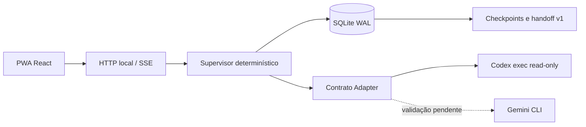
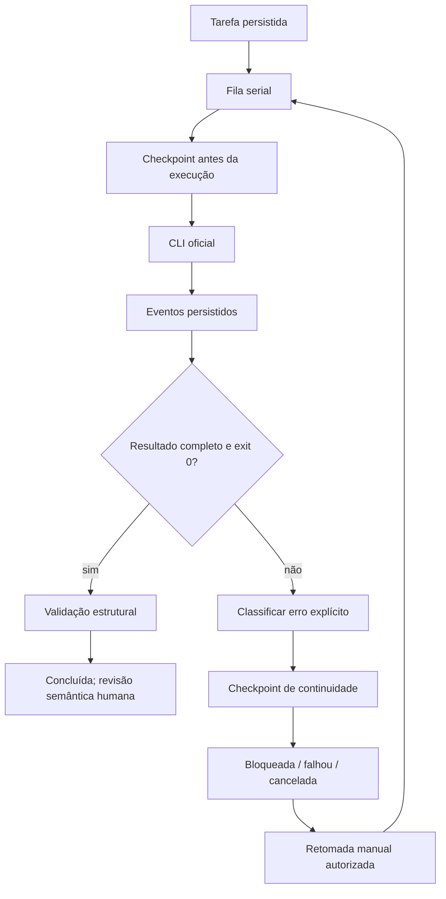

# Arquitetura incremental

Atualização v0.2: [Google e REA](GOOGLE-REA.md) documenta os novos adaptadores Antigravity/Gemini, motor estático REA e workflow de três etapas persistidas. O texto original a seguir descreve a base v0.1 e deve ser lido com essa atualização.

## Decisão

React/TypeScript/Vite para PWA; backend Python 3.9+ com HTTP padrão e SQLite WAL. FastAPI é evolução possível, mas não necessária para este MVP local. Um processo backend independente da UI e um worker serial evitam conflitos. Bind exclusivo em 127.0.0.1. Origem e Host estritos, JSON obrigatório em mutações, sem CORS; frontend servido na mesma origem. Não expor na rede: TLS/autenticação de usuários são requisitos antes de acesso remoto. Credenciais ficam exclusivamente no armazenamento oficial das CLIs. Chaves de API são removidas do ambiente dos processos Codex para não introduzir cobrança por API acidentalmente.

Failover futuro: apenas erro estruturado de cota/autenticação → suspender provedor → checkpoint transacional → verificar agente alternativo validado → validar pacote → executar etapa pendente serialmente. Sem agente validado, bloquear e oferecer exportação de contexto. MVP não tenta automaticamente outro provedor.

## Persistência e contrato

projects(id,name,path), tasks(id,project_id,objective,provider,status,result,usage,error,timestamps), events(id,task_id,kind,payload,time), checkpoints(id,task_id,payload,time), memory(id,project_id,content,time), commands(key,task_id). Checkpoint + evento + atualização de estado na mesma transação. Pacote v1 contém objetivo integral, restrições, resultado confirmado, próximos passos e referência à origem. Históricos não são truncados silenciosamente: eventos ficam no banco; pacote usa resultado e objetivo essenciais. Tokens são reportados ou nulos; estimativa por caracteres é identificada como estimativa. Nenhum percentual de economia é calculado sem benchmark.

Adapter declara id, instalação, autenticação, capabilities, execute(task,on_event,cancel). Codex valida login antes de executar, usa argv sem shell, read-only e approval never: ações que requerem permissão falham. Tempo máximo e cancelamento encerram grupo de processos no POSIX. Gemini é descritor indisponível, sem execução habilitada. Extensões futuras devem implementar contrato e testes próprios antes de ativação.

Reinício marca queued/running como interrupted e registra checkpoint. Não retoma automaticamente, evitando repetição de efeitos. Estado confirmado significa evento/resultado persistido, não pensamento oculto. Checkpoints deste MVP não são snapshots de filesystem: agentes não têm escrita. Recuperação do banco usa backup SQLite consistente, nunca cópia durante WAL ativo.

## Frontend e PWA

Overview, Workspace, Tasks, Agents, Memory, Analytics, Activity, Settings; filtros por projeto, palette Cmd/Ctrl+K, tema persistido, responsividade. SSE leva eventos duráveis; reconexão busca snapshot completo. IndexedDB conserva último snapshot somente para leitura offline. SW guarda apenas shell e recursos estáticos; /api nunca entra no cache. Backend recebe chave idempotente por comando. Offline desabilita mutações. Sem streaming inventado: eventos exibem apenas saídas recebidas da CLI.

## Testes e fases restantes

Testes determinísticos do banco, recuperação, cancelamento, idempotência, classificação, handoff e adaptadores falsos. Smoke real Codex separado para evitar cotas. Teste browser para navegação, criação, resultado, persistência, tema, SW e offline. Instalação PWA deve ser confirmada manualmente em navegador compatível; auditoria WCAG/Lighthouse não presumida.

MVP: tarefas de análise/planejamento somente leitura, filas, checkpoints, logs, memória, métricas e PWA. Fases seguintes: Gemini autenticado, validação de handoff, worktrees e escrita com política de aprovação, grafo de etapas/dependências, failover real, compactação avaliada, benchmarks A/B/C, notificações, retenção e auditoria de acessibilidade. Estas fases não são consideradas entregues pelo MVP.
